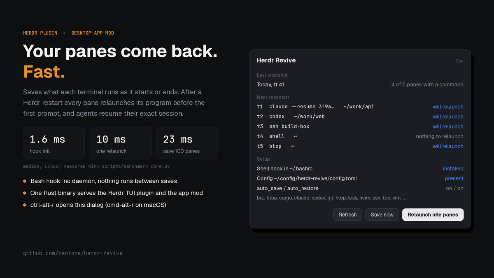
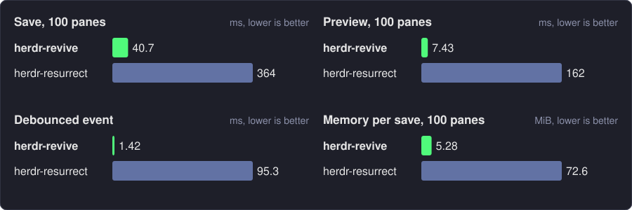

# herdr-revive

**Reboot it. Crash it. Quit it. It all comes back.**

[](LICENSE)

[](https://github.com/cantona/herdr-revive/releases)

Herdr brings back your layout after a restart. herdr-revive brings back
**what was running in it**: the SSH session, `journalctl -f`, the dev server,
`top`, and your coding agents, each on its exact conversation, in its own
folder. It works in the herdr TUI and in the Herdr desktop app.



## Why you want it

You close the lid, the machine reboots overnight, or herdr-core restarts.
Without Revive, every pane comes back as an empty shell, and you spend the
first ten minutes of the day retyping commands and digging up agent session
IDs. With Revive, they are already running again.

- **Your agents keep their conversations.** Claude Code, Codex, Gemini,
  Copilot and Cursor resume their exact session, never "the latest one". In
  the TUI, Herdr tells Revive each agent's session. In the desktop app, a
  plain `claude` is found from the session record Claude Code writes (seen
  from 2.1.319 on); the other agents need their session on the command line
  (`codex resume <id>`), or they come back as a shell in their folder. With
  a launcher rule, a wrapper such as `claude-local` comes back with its own
  profile.
- **Your programs come back where they were.** Each allowlisted program
  starts again in its own folder, with its own arguments.
- **Fast enough to forget about.** Against herdr-resurrect on 100 panes
  (median): saves **8.9x faster**, previews **21.8x faster**, events that
  need no save **67x faster**, with **92.7% less memory** per save
  ([benchmarks](#benchmarks)). In the desktop app, the relaunch runs before
  the pane's first prompt, and Revive's part of it takes about **10 ms**.
- **No daemon.** In the TUI, Herdr's own events start each save. In the
  desktop app, a small bash hook saves as programs start and end. Nothing
  sits in the background.
- **You stay in control.** Only programs you allowlist ever run. You can
  preview a restore before it happens and pick an older snapshot. In the TUI
  you can also keep a layout as a named space and open it again whenever you
  like.
- **Move between the TUI and the app.** `herdr-revive migrate` copies a TUI
  session into app spaces, or app spaces into the TUI, on this machine or on
  any machine you reach with `hc`. Tabs, splits, folders and commands come
  along, agents resume, and the source is never touched.

## Quick start

You need Linux or macOS, Rust/Cargo 1.97.1 or newer and a C linker (on
macOS, `xcode-select --install`), and the herdr TUI 0.9.1 or newer or the
Herdr desktop app.

### Herdr desktop app

Open the app once first, so it writes its `keys.json`. Then:

```sh
cargo install --locked --git https://github.com/cantona/herdr-revive
herdr-revive install          # shows what it will change, asks y/N
```

`install` adds the dialog (`ctrl-alt-r`, `cmd-alt-r` on macOS) and the bash
hook. The dialog finds `herdr-revive` on the app's `PATH`, in
`~/.local/bin` or in `~/.cargo/bin`. Then switch on saving and restoring in
`~/.config/herdr-revive/config.toml`:

```toml
auto_save = true
auto_restore = true
allowed_programs = ["ssh", "journalctl", "top", "claude", "codex"]
```

Open a new pane and work as usual. After the next restart, your panes come
back by themselves.

### herdr TUI

```sh
herdr plugin install cantona/herdr-revive --ref v0.3.0
herdr plugin config-dir cantona.herdr-revive    # put config.toml here
```

Use the same `config.toml` as above. For agent restore, also set
`resume_agents_on_restore = false` under `[session]` in Herdr's own
`config.toml`, so Herdr's built-in agent restore does not start a plain
`claude` first.

Everything starts switched off, and nothing runs until you allowlist it.
[`config.example.toml`](config.example.toml) lists every option.

## What you can do

| You want to... | herdr TUI (plugin action) | Desktop app (terminal) |
| --- | --- | --- |
| Save the session now | `save` | `herdr-revive --host core save` |
| See what a restore would do | `preview` | `herdr-revive --host core preview` |
| Bring panes back | `restore` | `herdr-revive --host core restore` |
| Pick an older snapshot | `manage` | `herdr-revive --host core restore --snapshot FILE` |
| Keep a layout and reopen it | `save-space`, then `open-space` | not on the app |
| Check status and setup | | `herdr-revive --host core status` |
| Copy the TUI session into the app | same command | `herdr-revive migrate --to app` |
| Copy app spaces into the TUI | same command | `herdr-revive migrate --to tui` |

In the desktop app, the dialog shows the last snapshot, what the next start
would relaunch, and whether the hook is installed. Its buttons save now,
relaunch idle panes and copy between the TUI and the app. Running
`herdr-revive` by hand against a TUI session also needs the plugin's paths;
the [guide](docs/GUIDE.md#commands) lists every command and option.

## How it compares

| | Herdr built-in | herdr-resurrect | **herdr-revive** |
| --- | --- | --- | --- |
| Layout, folders, focus | Yes | Yes | **Yes** |
| Relaunch ordinary programs | No | Allowlist | **Allowlist** |
| Exact agent conversations | Official integrations | Five agents | **Five agents, plus custom wrappers** |
| Snapshot history and preview | Recovery backups | Yes | **Yes** |
| Herdr desktop app | Yes | No | **Yes** |
| Runtime | Built in | Node.js | **Native binary; shell for popups** |

Use Herdr's built-in restore when layouts and its supported agents are all
you need. If you work in tmux, tmux-resurrect and tmux-continuum are the
equivalent there. The guide has the
[full comparison](docs/GUIDE.md#built-in-vs-herdr-resurrect-vs-tmux-plugins)
and the [feature-by-feature matrix](docs/PARITY.md).

## Benchmarks

<p align="center"></p>

| | herdr-revive 0.1.0 | herdr-resurrect | Difference |
|---|---|---|---|
| Save, 100 panes | **40.69 ms** | 363.82 ms | 8.9x faster |
| Preview, 100 panes | **7.43 ms** | 161.65 ms | 21.8x faster |
| Debounced event | **1.42 ms** | 95.25 ms | 67.1x faster |
| Memory per save, 100 panes | **5.28 MiB** | 72.57 MiB | 92.7% less |

Both plugins ran on the same private Herdr 0.9.1 sessions on Linux. Saves and
previews used 100 mixed panes (programs, idle shells and agents in 5
workspaces), the event one pane. Each figure is the median of 30 fresh
launches; memory is each process's peak RSS.
herdr-resurrect is
[c05b43d](https://github.com/cantona/herdr-resurrect/tree/c05b43dda3ff968cb21653b7f4188245015a15be);
herdr-revive uses its default direct transport. These are warm local
operations, not the time until a restore is ready, and they compare whole
implementations, not Rust against JavaScript.

The [benchmark report](docs/MATCHED_BENCHMARK.md) has the p95 values, every
pane count, the raw samples and how to reproduce the run. The chart is drawn
from those samples:

```sh
scripts/bench-chart.py assets/bench.svg docs/benchmarks/linux-matched-2026-09-18.json
```

## What it does not do

- **It restarts commands, not processes.** Process memory, network
  connections and unsaved editor buffers are not saved.
- **Only allowlisted programs run.** The allowlist decides what may start
  again; it is not a sandbox.
- **The desktop app hook is bash only.**
- **Existing panes are judged idle by their process tree,** which cannot
  prove the prompt is empty. Read the
  [safety limits](docs/GUIDE.md#recovery-and-safety-limits) before you turn on
  automatic restore.
- **Windows is not supported yet.**

An interrupted restore is never retried blindly. Revive keeps a journal and
waits for you to inspect and acknowledge it.

## Documentation

- [Guide](docs/GUIDE.md): installation, configuration, every command, the
  desktop app, migration, capture rules and safety limits.
- [Dialog recipe](RECIPE.md): what the desktop app dialog shows and does.
- [Contracts](docs/CONTRACTS.md): snapshot schema, storage, transport and
  agent options.
- [Validation](docs/VALIDATION.md) and [macOS](docs/MACOS.md): what has been
  tested, and how.
- [Benchmark report](docs/MATCHED_BENCHMARK.md): the raw samples and how to
  reproduce them.
- [Changelog](CHANGELOG.md).

## Contributing

```sh
cargo fmt --check
cargo clippy --locked --all-targets -- -D warnings
cargo test --locked
```

The guide's [verification list](docs/GUIDE.md#verification) has the
integration suites. Tests use private sockets and temporary directories; they
never touch your real Herdr session.

## License

Copyright 2026 Su Kang Yin. Licensed under the [Apache License 2.0](LICENSE).
Third-party notices are in [THIRD_PARTY_NOTICES.md](THIRD_PARTY_NOTICES.md).
