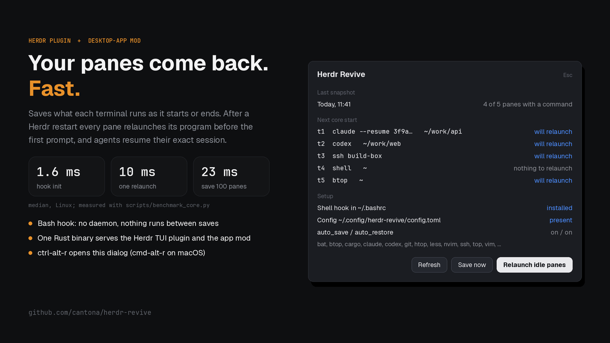

# Herdr Revive

A dialog, opened with `ctrl-alt-r` (`cmd-alt-r` on macOS), that shows what herdr-revive last saved
from your herdr-core terminals, which of those programs the next core start
would relaunch, and whether the shell hook and config are in place. Three
buttons save now, relaunch idle panes now, or read the facts again.

## What you see

One dialog, 560px wide, drawn on the theme's `popover` color with 18px
padding and 8px corners. Text is 13px.

- **Title row:** "Herdr Revive" in 15px semibold `foreground`, with a dim
  11px "Esc" hint on the right.
- **Body** (scrolls when long), in sections headed by an 11.5px `dim` label:
  - **Last snapshot:** the snapshot's local date and time on the left; on the
    right "N of M panes with a command" in `muted`. Without a snapshot:
    "No snapshot yet. Run an allowed program in a pane, or press Save now."
  - **Next core start:** one row per saved pane: terminal id (or pane id),
    program (or "shell") and folder on the left, truncated; the decision on
    the right: "will relaunch" (`done`), "not in allowed_programs"
    (`blocked`), "pane is gone" and "moved to another tab" (`dim`), "nothing
    to relaunch" (`muted`). Hidden when there is no snapshot or it has no
    panes.
  - **Recovery:** only when a relaunch stopped part way: a `blocked` line
    "A relaunch stopped in state <state>; saves and relaunches wait until it
    is acknowledged." and an "Acknowledge without retry" button.
  - **Setup:** "Shell hook in <rc file>" with "installed" (`done`),
    "missing" or "update needed" (`blocked`, followed by the command
    `herdr-revive --host core install --write`), or "unreadable" (`blocked`,
    followed by the error text). Then "Config <dir>/config.toml" with
    "present" (`done`) or "defaults" (`muted`); "auto_save / auto_restore"
    with "on" / "off" each; "allowed_programs" as a comma list or "none".
- **Button row**, right-aligned, 8px apart: "Refresh", "Save now" (both
  `raised` with an `input` border) and "Relaunch idle panes" (`solid` with
  `solid_foreground` text). Buttons are 30px tall, 12px side padding, 8px
  corners, 12.5px medium text. "Relaunch idle panes" asks first: a `blocked`
  line says how many panes will relaunch and that each command is typed into
  its pane's prompt, after anything typed there and not entered; "Cancel"
  and "Relaunch" then replace it.

Other bodies replace the sections: "Reading..." while status runs; "Another
herdr-revive operation is running. Refresh in a moment." while another run
holds the session lock; or one of these error bodies:

- "herdr-revive could not be started." (`blocked`), then "Install the
  current version, then open this dialog again:",
  `cargo install --locked --git https://github.com/cantona/herdr-revive`
  and the raw start error in small `dim` text.
- "herdr-revive is too old for this dialog." when the binary's output says
  `unexpected argument '--host'` or `unrecognized subcommand` (a release from
  before the core host), then the same install lines and the error line in
  small `dim` text.
- Any other nonzero exit, in `blocked`: the output's line starting with
  `error:`, else its first three non-empty lines, else "herdr-revive exited
  with code N".
- "unreadable status output: <parse error>" when the output is not JSON.
- A timeout or other `exec` rejection, shown as its message (for example
  "herdr-revive took longer than 30 s and was stopped").

## How it behaves

- `ctrl-alt-r` (`cmd-alt-r` on macOS, where Option types characters instead of
  acting as Alt) opens the dialog; pressing it again, or Esc, closes it.
- On open it runs status once. Nothing refreshes on a timer.
- A button shows "..." while its command runs, and all buttons dim to 60%
  while a command or a status read runs; clicks on any button are ignored
  until both the command and the status read after it finish. A command
  that exits nonzero posts an error toast titled "herdr-revive save failed"
  (or restore, ack) with its `error:` line, else its first three non-empty
  lines, else "exited with code N".
- "Refresh" shows "Reading..." and runs status again; it too is ignored
  while a read or command runs.
- Buttons fade slightly on hover. The mod shows no agent statuses (working,
  blocked, done, idle); it only reports what herdr-revive returns.

## Built from

- `mods/herdr-revive/mod.json`:
  `{ "place": "none", "title": "herdr-revive", "overlay": { "kind": "dialog", "width": 560 } }`.
  No layout block; `mod.open` shows it as a dialog.
- `keys.json`: `{ "global": { "ctrl-alt-r": "mod.open:herdr-revive", "cmd-alt-r": "mod.open:herdr-revive" } }`,
  merged into the person's own `keys.json`.
- `mods/herdr-revive/main.js`, one `View`:
  - `exec("herdr-revive", ["--host","core","status"])` in `cx.spawn`, parsed
    as JSON. The dialog draws `result.latest`, `result.panes`,
    `result.recovery.pending`, `result.config` and `result.install`; a
    top-level `{"status":"operation_in_progress"}` is the lock message.
  - The buttons run `herdr-revive --host core save`,
    `herdr-revive --host core restore --rehydrate` and
    `herdr-revive --host core recovery acknowledge <pending.generation>`.
  - `notify` for failures, `closeOverlay(props().overlay)` on Esc, `theme()`
    for every color, `cx.focus_handle()` with `track_focus` and
    `on_key_down` for Esc.
- The mod runs one program, `herdr-revive`, and reads nothing else: no files,
  no network, no `hc`. No art.

## Watch out

- The dialog reads `~/.config/herdr-revive/config.toml`. To share the TUI
  plugin's config, link the directory:
  `ln -s ~/.config/herdr/plugins/config/cantona.herdr-revive ~/.config/herdr-revive`.
  A symlinked `config.toml` itself is refused.
- `herdr-revive` must be on the PATH the app process itself has: `exec`
  runs it by bare name. `cargo install` puts it in `~/.cargo/bin`, which a
  Linux desktop session started outside your shell may not have; link it
  into a directory that session has (for example `~/.local/bin`) if the
  dialog says herdr-revive could not be started.
- Status is read once per open and after each button, never on a timer, so
  the dialog does not follow saves made elsewhere until Refresh.
- `exec` inherits the app's `HC_SESSION`. A core started with another session
  name is not the one the dialog reads or acts on.
- A pending recovery makes Save and Relaunch fail until it is acknowledged;
  the dialog shows the Recovery section and the toast says why.
- The relaunch button passes `--rehydrate` to state that it only relaunches
  programs in panes that still exist and never rebuilds closed spaces. On
  the core host a plain `restore` does the same, because core snapshots
  store no layout to rebuild from.
- On herdr-app 0.1.13 `exec` has a fixed 30 s limit; the `timeout` option
  the mod passes is honored only by later app versions. A relaunch that
  takes longer is stopped and reported as failed.
- The status output must stay JSON with `result` at the top level; the lock
  message is the one exception.

## Done when

- `herdr-app check mods/herdr-revive` passes.
- Opening with `ctrl-alt-r` (`cmd-alt-r` on macOS) shows the last snapshot's time.
- "Save now" changes that time.
- With `herdr-revive` off PATH, the dialog shows the install command.
- Esc closes the dialog.
